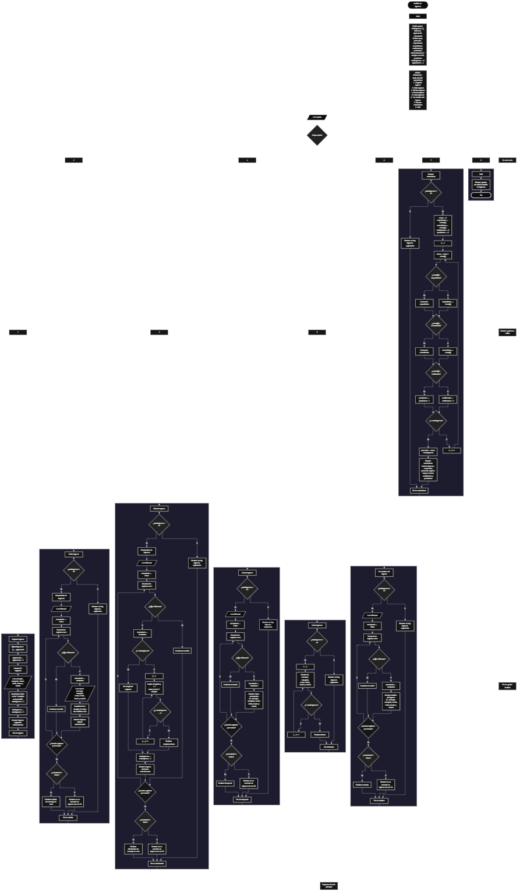

 

Este proyecto, llamado <b>análisis de ingresos</b>, fue desarrollado en <b>pseint</b> como un ejercicio práctico para fortalecer la lógica de programación mediante la creación de un sistema de gestión y análisis de ingresos desde la consola. El programa cuenta con un menú principal de ocho opciones que permite <b>registrar, editar, eliminar, buscar, listar y consultar los detalles</b> de los ingresos registrados, además de calcular estadísticas generales. Cada ingreso almacena información como el concepto, la categoría, el monto, la fecha, la fuente y el estado, junto con un identificador numérico que permite localizar cada registro. Para organizar los datos, se utilizan siete arreglos con una capacidad definida de <b>100 posiciones cada uno</b>, así como variables que controlan la cantidad de ingresos almacenados y la asignación de identificadores. Durante su desarrollo se aplicaron conceptos fundamentales de programación, como variables, arreglos, estructuras condicionales, ciclos repetitivos y estructuras de selección, además de procesos para buscar, modificar, eliminar y reorganizar registros. Este proyecto permite poner en práctica los conocimientos adquiridos en PSeInt y comprender cómo administrar información financiera básica mediante un programa de consola.

<h2 align="center">⚙️ Funcionamiento del menú principal</h2>

### ➕ Registrar ingreso

La opción <b>1) registrar ingreso</b> permite almacenar un nuevo ingreso en el sistema. Para comenzar, el programa utiliza la variable <b>siguienteID</b> para asignar un identificador al nuevo registro y lo guarda en el arreglo <b>id</b>, utilizando la posición <b>totalIngresos + 1</b>. Después, incrementa <b>siguienteID</b> en uno y muestra el identificador asignado. A continuación, solicita el <b>concepto, la categoría, el monto, la fecha, la fuente y el estado</b> del ingreso, almacenando cada dato en la posición correspondiente de su respectivo arreglo. Finalmente, incrementa la variable <b>totalIngresos</b> en uno y presenta el mensaje <b>"ingreso registrado correctamente."</b>. En el código actual, el registro no comprueba si se ha alcanzado la capacidad máxima de los arreglos ni valida los datos introducidos antes de almacenarlos.

### ✏️ Editar ingreso

La opción <b>2) editar ingreso</b> permite modificar los datos de un ingreso registrado mediante su identificador. Primero, el programa comprueba si la variable <b>totalIngresos</b> es igual a cero. Si no existen registros, muestra el mensaje <b>"no hay ingresos registrados."</b>. En caso contrario, presenta una lista con los identificadores, conceptos, categorías, montos, fechas, fuentes y estados de los ingresos almacenados. Después, solicita el ID del ingreso que se desea editar y establece la variable lógica <b>encontrado</b> en <b>Falso</b>. Mediante un ciclo <b>para</b>, recorre los registros y compara cada identificador con el valor introducido. Cuando encuentra una coincidencia, establece <b>encontrado</b> en <b>Verdadero</b> y solicita los nuevos datos del concepto, la categoría, el monto, la fecha, la fuente y el estado, actualizando directamente los arreglos correspondientes. El identificador original se conserva. Finalmente, muestra el mensaje <b>"ingreso editado correctamente."</b>. Si no encuentra el ID solicitado, presenta el mensaje <b>"no se encontró un ingreso con ese id."</b>.

### 🗑️ Eliminar ingreso

La opción <b>3) eliminar ingreso</b> permite eliminar un ingreso mediante su identificador. Antes de realizar la operación, el programa comprueba si existen registros. Si <b>totalIngresos</b> es igual a cero, muestra el mensaje <b>"no hay ingresos registrados."</b>. Si existen ingresos, presenta una lista de los registros con todos sus datos y solicita el ID que se desea eliminar. La variable <b>encontrado</b> se inicializa en <b>Falso</b> y un ciclo <b>para</b> recorre los identificadores hasta encontrar una coincidencia. Cuando encuentra el ingreso, establece la variable en <b>Verdadero</b>. Si el registro no ocupa la última posición, utiliza un segundo ciclo <b>para</b>, controlado por la variable <b>j</b>, para desplazar una posición hacia atrás los datos de los arreglos <b>id, concepto, categoria, monto, fecha, fuente y estado</b>. Después, disminuye <b>totalIngresos</b> en uno y muestra el mensaje <b>"ingreso eliminado correctamente."</b>. Si no encuentra el identificador solicitado, muestra el mensaje <b>"no se encontró un ingreso con ese id."</b>. En el código actual, no se limpia expresamente la última posición después del desplazamiento y el ciclo exterior continúa ejecutándose tras la eliminación.

### 🔎 Buscar ingreso

La opción <b>4) buscar ingreso</b> permite localizar un registro mediante su identificador. Primero, el programa comprueba si existen ingresos registrados. Si no hay información almacenada, presenta el mensaje <b>"no hay ingresos registrados."</b>. En caso contrario, solicita el ID del ingreso y establece la variable lógica <b>encontrado</b> en <b>Falso</b>. Después, utiliza un ciclo <b>para</b> para recorrer los registros y comparar cada elemento del arreglo <b>id</b> con el identificador introducido. Cuando encuentra una coincidencia, cambia <b>encontrado</b> a <b>Verdadero</b>, muestra el mensaje <b>"datos encontrados"</b> y presenta el identificador, el concepto, la categoría, el monto, la fecha, la fuente y el estado del ingreso. Si finaliza el recorrido sin encontrar el registro solicitado, muestra el mensaje <b>"no se encontró un ingreso con ese id."</b>. El ciclo continúa recorriendo los registros después de encontrar una coincidencia.

### 📋 Listar ingresos

La opción <b>5) listar ingresos</b> permite visualizar todos los ingresos registrados en el sistema. Antes de mostrar los datos, el programa comprueba si <b>totalIngresos</b> es igual a cero. Si no existen registros, presenta el mensaje <b>"no hay ingresos registrados."</b>. Si hay información disponible, muestra el encabezado <b>"datos registrados"</b> y utiliza un ciclo <b>para</b> para recorrer los arreglos desde la primera posición hasta la cantidad total de ingresos. Durante cada repetición, presenta el ID, el concepto, la categoría, el monto, la fecha, la fuente y el estado del ingreso correspondiente. Esta operación permite consultar los registros almacenados sin tener que buscarlos individualmente.

### 📄 Ver detalles del ingreso

La opción <b>6) ver detalles del ingreso</b> permite consultar individualmente la información de un ingreso específico. Primero, el programa verifica si existen registros. Si no hay ingresos almacenados, muestra el mensaje <b>"no hay ingresos registrados."</b>. En caso contrario, solicita el identificador del ingreso que se desea consultar e inicializa la variable <b>encontrado</b> en <b>Falso</b>. A continuación, recorre los registros mediante un ciclo <b>para</b> y compara cada ID con el valor introducido. Cuando encuentra una coincidencia, establece <b>encontrado</b> en <b>Verdadero</b> y muestra el encabezado <b>"detalles del ingreso"</b>, seguido de cada dato en una línea independiente: <b>ID, concepto, categoría, monto, fecha, fuente y estado</b>. Si el identificador no coincide con ningún registro, presenta el mensaje <b>"no se encontró un ingreso con ese id."</b>.

### 📊 Mostrar estadísticas

La opción <b>7) mostrar estadísticas</b> permite analizar los ingresos registrados y obtener información general sobre sus montos y estados. Primero, el programa comprueba si existen ingresos almacenados. Si <b>totalIngresos</b> es igual a cero, muestra el mensaje <b>"no hay ingresos registrados."</b>. En caso contrario, inicializa <b>suma</b> en cero, establece <b>mayorMonto</b> y <b>menorMonto</b> con el monto del primer ingreso y reinicia los contadores <b>confirmados</b> y <b>pendientes</b> en cero. Después, utiliza un ciclo <b>para</b> para recorrer todos los ingresos. En cada repetición, acumula el monto en <b>suma</b>, compara el monto actual con los valores de mayor y menor monto y actualiza los resultados cuando corresponde. También comprueba si el estado es igual a <b>"confirmado"</b>; si lo es, incrementa <b>confirmados</b>, y si no, incrementa <b>pendientes</b>. Al finalizar el recorrido, calcula el promedio mediante la operación <b>suma / totalIngresos</b> y muestra el total de ingresos, el monto acumulado, el promedio, el ingreso de mayor monto, el ingreso de menor monto y las cantidades de ingresos confirmados y pendientes. El cálculo considera como pendientes todos los estados diferentes de <b>"confirmado"</b>.

### 🚪 Salir del menú principal

La opción <b>8) salir</b> permite finalizar la ejecución del programa y muestra el mensaje <b>"gracias por utilizar analisis de ingresos."</b>. El menú principal se encuentra dentro de una estructura repetitiva <b>repetir ... hasta que</b>, cuya condición final es <b>opcion = 8</b>. Por lo tanto, cuando el usuario selecciona la opción 8, el ciclo termina después de ejecutar el mensaje de despedida. Esta condición coincide con el número asignado a la opción de salida del menú.

<h2 align="center">🧠 Temas aplicados en el proyecto</h2>

### 📦 Variables

En este proyecto se utilizan variables para controlar la selección del menú, contar los ingresos registrados, asignar identificadores, recorrer los arreglos, localizar registros, realizar cálculos estadísticos y contabilizar los estados de los ingresos. Cada variable cumple una función específica dentro de las operaciones del sistema.

🔢 **Opcion:** Almacena la opción seleccionada por el usuario en el menú principal.

📊 **TotalIngresos:** Indica la cantidad actual de ingresos registrados.

🆔 **SiguienteID:** Almacena el próximo identificador que se asignará a un ingreso nuevo.

🔎 **IdBuscar:** Almacena el identificador introducido para localizar un ingreso.

🔄 **I:** Controla los recorridos de los arreglos en las operaciones de edición, eliminación, búsqueda, listado, consulta y estadísticas.

🔁 **J:** Controla el desplazamiento de los datos de los arreglos durante la eliminación de un ingreso.

✅ **Encontrado:** Variable lógica que indica si se localizó el identificador solicitado.

📝 **Concepto y categoria:** Almacenan la descripción y clasificación del ingreso.

💰 **Monto:** Almacena el valor monetario de cada ingreso.

📅 **Fecha:** Almacena la fecha asociada al ingreso.

🏦 **Fuente:** Almacena el origen del ingreso.

📌 **Estado:** Almacena el estado del ingreso, como confirmado o pendiente.

📈 **Suma y promedio:** Permiten calcular el monto total y el promedio de los ingresos registrados.

⬆️ **MayorMonto y menorMonto:** Almacenan los valores más alto y más bajo encontrados durante el análisis.

🔢 **Confirmados y pendientes:** Cuentan los ingresos según la comprobación de su estado.

### 🗃️ Arreglos

El programa utiliza siete arreglos con una capacidad definida de <b>100 posiciones cada uno</b>. Todos se relacionan mediante el mismo índice, de manera que los datos almacenados en una posición corresponden al mismo ingreso. Por ejemplo, la información del registro ubicado en la primera posición se distribuye entre <b>id[1], concepto[1], categoria[1], monto[1], fecha[1], fuente[1] y estado[1]</b>. Esta organización facilita almacenar, recorrer, consultar, editar y eliminar los registros. La capacidad declarada es de 100 posiciones, pero el código actual no incluye una comprobación que impida registrar más ingresos cuando se alcanza ese límite.

🆔 **Id[100]:** Almacena los identificadores de los ingresos.

📝 **Concepto[100]:** Almacena los conceptos o descripciones de los ingresos.

📂 **Categoria[100]:** Almacena las categorías de los ingresos.

💰 **Monto[100]:** Almacena los valores monetarios registrados.

📅 **Fecha[100]:** Almacena las fechas asociadas a los ingresos.

🏦 **Fuente[100]:** Almacena el origen de cada ingreso.

📌 **Estado[100]:** Almacena el estado de cada ingreso.

### 🔀 Estructuras condicionales

Las estructuras <b>si</b> y <b>siNo</b> permiten tomar decisiones durante la ejecución del programa. Se utilizan para comprobar si existen ingresos registrados antes de realizar una operación, comparar los identificadores para localizar un ingreso, determinar si se debe desplazar información durante una eliminación, comparar los montos para calcular los valores mayor y menor y clasificar los ingresos según su estado. Estas condiciones permiten ejecutar instrucciones diferentes según los datos y los resultados obtenidos durante cada operación.

### 🔄 Estructuras repetitivas

El programa utiliza los ciclos <b>para</b> y <b>repetir ... hasta que</b>. Los ciclos <b>para</b> permiten recorrer los arreglos para mostrar, buscar, editar y consultar ingresos, así como calcular las estadísticas. También se emplea un ciclo <b>para</b> interno con la variable <b>j</b> para desplazar los datos de los registros posteriores cuando se elimina un ingreso. Por otra parte, el ciclo <b>repetir ... hasta que</b> mantiene activo el menú principal hasta que el usuario selecciona la opción 8.

### 🎯 Estructura según

La estructura <b>segun</b> evalúa el valor almacenado en la variable <b>opcion</b> y ejecuta el bloque de instrucciones correspondiente. Cada caso representa una de las ocho opciones del menú: registrar, editar, eliminar, buscar, listar, ver detalles, mostrar estadísticas o salir. El bloque <b>de otro modo</b> se utiliza para mostrar el mensaje <b>"opción no válida."</b> cuando el valor introducido no coincide con ninguna de las opciones definidas.

### 🔢 Dimensionamiento de arreglos

La instrucción <b>dimension</b> establece el tamaño de los arreglos utilizados para almacenar la información de los ingresos. En este proyecto, cada arreglo se declara con <b>100 posiciones</b>. La variable <b>totalIngresos</b> controla cuántos registros se consideran activos durante las operaciones. Al registrar un ingreso, se utiliza la posición <b>totalIngresos + 1</b>; al eliminarlo, se reduce el contador después del proceso de desplazamiento. Sin embargo, el programa no verifica que exista espacio disponible antes de utilizar una nueva posición.

### 🔄 Reorganización de registros

Cuando se elimina un ingreso que no ocupa la última posición, el programa utiliza el ciclo <b>para</b> controlado por <b>j</b> para copiar los datos de cada posición siguiente sobre la posición actual. Este desplazamiento se realiza en los siete arreglos: <b>id, concepto, categoria, monto, fecha, fuente y estado</b>. Después, la variable <b>totalIngresos</b> disminuye en uno, de manera que el sistema considere una cantidad menor de registros activos. El código no limpia expresamente la última posición ni detiene el ciclo exterior inmediatamente después de encontrar y eliminar el registro, aspectos que conviene tener presentes al analizar su comportamiento.

<h2 align="center">¿Cómo se implementaron las operaciones CRUD en el proyecto?</h2>

Las operaciones <b>CRUD</b> se implementaron mediante las opciones del menú principal para administrar los ingresos registrados. La operación <b>crear</b> corresponde a <b>registrar ingreso</b>, donde se introducen los datos de un nuevo registro; <b>leer</b> se realiza mediante las opciones <b>buscar ingreso, listar ingresos y ver detalles del ingreso</b>; <b>actualizar</b> corresponde a <b>editar ingreso</b>, donde se modifican los datos de un ingreso existente; y <b>eliminar</b> se realiza mediante la opción <b>eliminar ingreso</b>, que desplaza los datos posteriores para reorganizar los registros activos. Estas operaciones utilizan arreglos, variables, estructuras condicionales y ciclos repetitivos para administrar temporalmente la información durante la ejecución del programa.

<h2 align="center">Diagrama de flujo del proyecto</h2>

<h2 align="center">🛡️ Validaciones del programa</h2>

### 📭 No existen ingresos registrados

Esta comprobación se utiliza en las opciones de <b>editar, eliminar, buscar, listar, ver detalles y mostrar estadísticas</b>. El programa verifica si <b>totalIngresos</b> es igual a <b>0</b>. Si no existen registros, muestra el mensaje <b>"no hay ingresos registrados."</b> y evita continuar con las instrucciones que requieren información almacenada. Esta comprobación permite manejar el caso en el que el usuario intenta utilizar una operación sin haber registrado ingresos.

### 🔎 Ingreso no encontrado

Esta comprobación se utiliza en las operaciones de <b>editar, eliminar, buscar y ver detalles</b>. Antes de recorrer los registros, el programa establece la variable lógica <b>encontrado</b> en <b>Falso</b>. Cuando localiza un identificador coincidente, cambia su valor a <b>Verdadero</b>. Si finaliza el recorrido sin encontrar el ID solicitado, muestra el mensaje <b>"no se encontró un ingreso con ese id."</b>. La variable permite distinguir entre una búsqueda exitosa y una búsqueda sin coincidencias.

### 📌 Clasificación por estado

En la opción de estadísticas, el programa comprueba si el contenido del arreglo <b>estado</b> es igual a <b>"confirmado"</b>. Si la comparación es verdadera, incrementa el contador <b>confirmados</b>; de lo contrario, incrementa <b>pendientes</b>. Esta clasificación no verifica expresamente que el estado introducido sea uno de los dos valores esperados. Por ello, cualquier texto diferente de <b>"confirmado"</b>, incluidos valores distintos de <b>"pendiente"</b>, se contabiliza como pendiente.

### ⚠️ Capacidad de los arreglos

Los arreglos se dimensionan con <b>100 posiciones</b>, pero el código actual no contiene una condición que compruebe si <b>totalIngresos</b> es menor que 100 antes de registrar otro ingreso. Por tanto, el programa no controla expresamente el límite máximo de almacenamiento. Para reforzar esta parte en una futura versión, se podría incorporar una comprobación de capacidad antes de asignar el nuevo identificador y solicitar los datos.

### ⚠️ Validación de los datos introducidos

El programa solicita el concepto, la categoría, el monto, la fecha, la fuente y el estado de cada ingreso, pero no incluye comprobaciones específicas para impedir campos vacíos, montos negativos o fechas incorrectas. Tampoco restringe el estado a las opciones <b>"confirmado"</b> y <b>"pendiente"</b>. Estas validaciones podrían incorporarse posteriormente para mejorar la consistencia de la información almacenada.

### ⚠️ Eliminación y recorrido de registros

Durante la eliminación, el programa disminuye <b>totalIngresos</b> dentro del ciclo que recorre los registros y continúa ejecutando las iteraciones restantes. Debido a que el número de registros activos cambia mientras el ciclo está en ejecución, conviene revisar este comportamiento si se desea garantizar que solo se elimine el registro seleccionado. Además, el código no limpia expresamente la última posición después de desplazar los datos, aunque esa posición deja de formar parte de los registros activos cuando disminuye el contador.

### ❌ Opción no válida

La estructura <b>segun</b> incluye el bloque <b>de otro modo</b>, que muestra el mensaje <b>"opción no válida."</b> cuando el usuario introduce una opción diferente de los valores definidos entre 1 y 8. La condición de salida del ciclo es <b>hasta que opcion = 8</b>, por lo que la opción 8 finaliza el menú correctamente. La opción inválida no termina el ciclo, permitiendo que el usuario vuelva a seleccionar una operación.

### 💾 Almacenamiento temporal

Los ingresos se almacenan en los arreglos durante la ejecución del algoritmo. El código no contiene instrucciones para guardar los registros en archivos ni en una base de datos. Por ello, los datos no cuentan con persistencia implementada y no se conserva su contenido mediante un mecanismo de almacenamiento permanente al finalizar la ejecución.

<h2 align="center">🎯 Objetivo del proyecto</h2>

El objetivo principal de este proyecto es fortalecer la <b>lógica de programación</b> mediante el desarrollo de un sistema de gestión y análisis de ingresos en <b>pseint</b>. A través de su construcción se aplican conocimientos sobre variables, arreglos, estructuras condicionales, ciclos repetitivos y estructuras de selección, integrándolos para resolver un problema de manera organizada. Además, el proyecto permite comprender cómo registrar, consultar, modificar y eliminar información, así como calcular estadísticas relacionadas con los montos y estados de los ingresos. De esta manera, constituye una base para desarrollar sistemas de administración financiera más completos utilizando otros lenguajes de programación y tecnologías.

